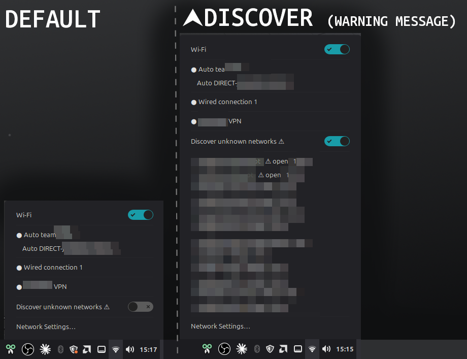

# Saved Networks (Cinnamon applet)

A network applet for the Cinnamon desktop that shows **only the networks you have saved**.
Nearby networks are never scanned or listed, so a stray click can't put you on someone's open
hotspot, and you don't have to scroll past forty neighbours' routers to find your own Wi-Fi.



## Features

- Saved Wi-Fi, wired, VPN and everything else (VLAN, …) in one menu. Click an entry to connect or
  disconnect.
- Saved Wi-Fi profiles without encryption are flagged `⚠ open` and ask for confirmation before
  connecting.
- **Discover unknown networks** switch for the rare moment you do need a new network:
  - off by default and never remembered, so it is off again after every login
  - shows a warning when you turn it on
  - switches itself off after 5 minutes, or as soon as you connect
- Enterprise (802.1X) and WEP networks are handed over to Cinnamon's Network Settings.

## Requirements

- Cinnamon desktop
- NetworkManager with `nmcli`
- `zenity` (confirmation and password dialogs)
- `notify-send`, usually from the `libnotify-bin` package (used by the login check)

## Install

```bash
git clone https://github.com/ultradr3mer/cinnamon-saved-networks.git
cd cinnamon-saved-networks
./install.sh
```

The installer will:

1. ask for an applet name (default `local`, which makes the applet id `saved-networks@local`;
   skip the question with `./install.sh --id NAME`)
2. copy the applet to `~/.local/share/cinnamon/applets/`
3. replace the stock `network@cinnamon.org` applet with this one, in the same panel slot
4. add a small login check to your autostart (skip with `--no-autostart`)

If you cloned straight into `~/.local/share/cinnamon/applets/saved-networks@NAME`, the installer
notices and uses that folder name instead of asking.

If the panel doesn't pick the applet up right away, restart Cinnamon (`Ctrl`+`Alt`+`Esc`, or
`Alt`+`F2`, type `r`, `Enter`).

### Why a login check?

If the applet ever stops being active (a panel reset, wiped settings, Cinnamon dropping a broken
applet), Cinnamon quietly falls back to the stock menu, which lists every nearby network. The
login check shows a critical notification in that case so you notice instead of clicking on the
wrong thing.

### Go back to the stock applet

```bash
./install.sh --restore
```

This puts the stock network applet back and removes the login check.

## Good to know

- **Passwords of new networks are briefly visible.** When you add a network through Discover, the
  password is passed to `nmcli` on the command line, so other local users can see it in the
  process list for a moment while it is being saved. On a single-user machine this is harmless;
  on a shared machine, add new networks through Network Settings instead.
- The stock applet is also Cinnamon's secret agent for password prompts. This applet asks for new
  Wi-Fi passwords itself; passwords of already saved profiles live in the profile and keep working.
- Open networks are never joined without an explicit confirmation, and Discover never saves
  anything automatically: new profiles are created with autoconnect off.

## Contributing

Pull requests are welcome, whether it's a typo, a bug fix or a new feature. Fork the repo, make
your change on a branch, and open a pull request with a short description of what and why. If
you want to try something bigger first, feel free to open an issue to talk it through.

The applet is a single file (`applet.js`) and the scripts are plain Bash, so there is no build
step. To test a change, install it with `./install.sh` and restart Cinnamon.

## License

[MIT](LICENSE)
